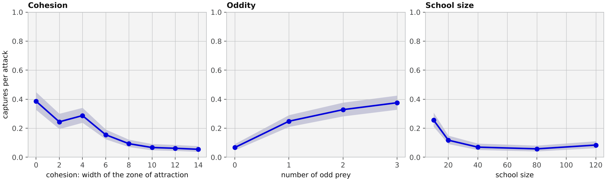

::: {.callout-tip}
## Optional extension

This page extends the [Couzin model](couzin-model.qmd). It adds a hunting predator to the school you already know and asks one question: **does blending in really protect you?**
:::

In open water prey have no shelter. A fish cannot hide, but it can be one of hundreds of look-alikes. A predator that has to track *one* individual while other bodies keep crossing its line of sight loses the target again and again. This is the **confusion effect** [@landeau1986oddity; @krause2002living]. The same logic explains why the animal that looks different (marked, limping, the wrong size) is the one that gets taken: the **oddity effect** [@landeau1986oddity].

The Couzin model has no predator. [Predator Avoidance](vicsek-predator.qmd) adds one, but as a point that scares particles away. Here the predator is a hunter with a limited ability to track, and the school is the same Couzin school as before.

## Three effects, one hunt

| Effect | What the predator experiences | How the model implements it |
|---|---|---|
| **Confusion** | Look-alikes cross the line of sight and tracking resets | A new prey inside the line of sight breaks the lock. Three broken locks waste the pass |
| **Confused strike** | A strike at one fish among many often misses | The strike succeeds with probability $P = 1/(1 + c\,\bar n)$ |
| **Oddity** | A visually different fish keeps the lock | An odd prey is targeted first, its lock cannot be broken, and it is captured with certainty |

The ideas come from the literature on predator confusion: from experiments with live predators [@ioannou2012predatory], and from simulations in which confusion alone is enough for swarming to evolve [@olson2013predator]. The lock and strike rules below are **teaching simplifications** in the same spirit. They are not a fit to any data set.

## From the Couzin model to a hunt

**The school.** Prey follow exactly the rules of the [Couzin model](couzin-model.qmd): repulsion first, then orientation and attraction, a blind sector behind, limited turning, Gaussian noise. The only dial we turn is **cohesion**, the width of the zone of attraction, $\Delta r_a = r_a - r_o$. We add one reflex: a prey within 4 body lengths of the predator turns directly away from it (at $120^\circ$/s, and $1.15\times$ faster).

**The predator.** It moves faster than the prey ($5$ against $3$ body lengths per second), has a $140^\circ$ frontal field of view, a range of $22$ body lengths and a limited turning rate. It is always in one of four states:

1. **Search.** Turn toward the nearest prey. As soon as prey are inside the field of view, pick a target: an odd prey if one is visible, otherwise the **most isolated** visible prey.
2. **Lock.** Chase the target. At every step, count the prey that lie within $\pm 8^\circ$ of the target's bearing and up to 8 body lengths behind it. These are the look-alikes in the line of sight. If a *new* one has entered the window, the lock breaks.
3. **Lost.** Continue straight for 0.3 s, then look for a target again. After **three** broken locks the pass is wasted.
4. **Recover.** After a capture, a miss or a wasted pass: go straight for 3 s, then search again.

If the predator gets within 0.9 body lengths of its target, it strikes. Let $\bar n$ be the mean number of look-alikes in the line of sight during the approach:

$$
P(\text{capture}) = \frac{1}{1 + c\,\bar n}.
$$ {#eq-strike}

With $c = 1$ one look-alike halves the chance of a capture, two reduce it to one third. With $c = 0$ the strike never misses, and only the broken locks protect the school. An **odd** prey skips both rules: no lock breaks and $P = 1$.

| Parameter | Value | | Parameter | Value |
|---|---|---|---|---|
| prey speed $s$ | 3 | | predator speed | 5 |
| $r_r$, $\Delta r_o$ | 1, 3 | | predator turning rate | $120^\circ$/s |
| $\Delta r_a$ (cohesion) | 10 (default) | | sight, field of view | 22, $140^\circ$ |
| field of perception, noise | $270^\circ$, 0.05 | | lock window | $\pm 8^\circ$, 8 behind |
| prey turning rate | $40^\circ$/s | | broken locks allowed | 3 |
| time step $\tau$ | 0.1 s | | confusion $c$ | 1 |

## Explore the hunt

The figure is the same model, ported to JavaScript. The camera follows the school. Prey are blue arrows. The predator is the large red arrow, and its field of view is the shaded sector. While it is locked, a dashed line and a white ring mark the target. A white ring that expands from the target is a broken lock. A **green** arrow with a white outline is an odd prey.

::: {.viz data-viz="confusion"}
1. Press **Dispersed** ($\Delta r_a = 0$) and watch about 20 attacks. Then press **Bait ball** ($\Delta r_a = 10$) and do the same. Which one has the higher capture probability, and why do the locks break more often in the second case?
2. In the bait ball, set the confusion $c$ to 0 and wait for 20 attacks. What still protects the school?
3. Add **one odd prey**. How does the capture probability change? Look at which prey the predator targets.
4. Change the school size from 30 to 100 at fixed cohesion. Does the capture probability keep falling?
5. With cohesion around 2 to 4 the school breaks into several groups. What happens to the capture probability, and why is cohesion not the only thing that matters?
:::

## Run it on your computer

From the repository root:

```bash
# the animation with sliders (IE dark theme)
python amlab/collective_motion/couzin_predator_animation.py

# options: light theme, two odd prey, weaker cohesion, a bigger school
python amlab/collective_motion/couzin_predator_animation.py --theme light --odd 2 --cohesion 4 --n 100

# save a GIF or an MP4 instead of opening a window (MP4 needs ffmpeg)
python amlab/collective_motion/couzin_predator_animation.py --save hunt.gif --frames 300

# self-test and a short cohesion sweep, without graphics
python amlab/collective_motion/couzin_predator.py
```

In the window, the sliders change cohesion and confusion $c$ live. School size and the number of odd prey restart the hunt. **Space** pauses.

## How the code extends `couzin.py`

The new module `couzin_predator.py` **reuses** `initialize_particles_couzin` and checks itself against `couzin_equations`. Only one thing changes in the school: the loop over individuals becomes array operations, so that a full hunt runs in a second.

```python
dx = x[None, :] - x[:, None]        # dx[i, j] = x_j - x_i
dy = y[None, :] - y[:, None]
d = np.hypot(dx, dy)
visible = (d <= radius_attraction) & (np.abs(wrap_pi(bearing - theta[:, None])) <= half_fov)
rep = visible & (d < radius_repulsion)                         # zone of repulsion
ori = visible & (d >= radius_repulsion) & (d < radius_alignment)   # zone of orientation
att = visible & (d >= radius_alignment) & (d < radius_attraction)  # zone of attraction
```

With the noise switched off the two versions must agree:

```python
from amlab.collective_motion.couzin_predator import check_against_original
print(check_against_original())   # about 1e-13: they are the same model
```

The predator is one class, `ConfusionSim`, with the four states above. The heart of the lock state is a few lines:

```python
# Look-alikes in the line of sight. A *new* one crossing it resets the lock.
cross = (np.abs(wrap_pi(bearing - bearing[t])) < np.deg2rad(p.lock_tol_deg)) \
        & (dist < dist[t] + p.clutter_depth)
cross[t] = False
new = cross & ~self._prev_cross
if new.any():
    self.breaks += 1            # lock broken
```

To run your own experiment:

```python
from amlab.collective_motion.couzin_predator import HuntParams, sweep

res = sweep("d_attract", [0, 4, 8, 12], base=HuntParams(), n_seeds=8, steps=3000)
print(res["values"], res["capture_prob"])
```

`sweep` runs `n_seeds` independent hunts for every value and returns the **captures per attack**, pooled over the runs. `ConfusionSim` has `stats`, `events` and `school_metrics()` if you want to measure anything else.

## Experiment: how much does blending in help?

`run_experiments.py confusion` reproduces the figure below in about two minutes. Each point pools 8 hunts of 300 s ($\approx$ 250 to 550 attacks). The shaded band is a 95% interval for the proportion.

{#fig-confusion-sweeps fig-alt="Three panels. Left: the capture probability falls from about 0.39 to 0.06 as cohesion grows from 0 to 14. Middle: it rises from 0.07 to 0.38 as the number of odd prey grows from 0 to 3. Right: it falls from about 0.26 to about 0.07 as the school grows from 10 to 40 and stays low."}

What the figure shows:

- **Cohesion.** The capture probability falls from about 0.39 for a school with no attraction to about 0.06 for a tight ball: a factor of 6 to 7. The curve is not monotonic for small $\Delta r_a$. There the school breaks into subgroups and its density depends on the run.
- **Oddity.** One odd prey in a tight school raises the capture probability from 0.07 to 0.25, three of them to 0.38, although all other prey are unchanged.
- **School size.** A school of 10 is much more vulnerable than one of 40 or more, but beyond a few dozen the gain saturates. Diminishing returns with group size are a familiar pattern in the literature on group living [@krause2002living].

::: {.callout-note}
## Exercise 1: confusion without a confused strike

Set $c = 0$ in the bait ball ($\Delta r_a = 10$). Is the school still safer than a dispersed one?

:::

::: {.callout-tip collapse="true"}
## Solution

Yes. With $c = 0$ every strike that reaches its target is a capture, so the strike no longer helps the school. But a tight school still **breaks the lock** often, and after three broken locks the pass is wasted. Run `sweep("d_attract", [0, 10], base=HuntParams(confusion=0.0))` and compare. The two rules are separate mechanisms, and you can switch one of them off at a time.
:::

::: {.callout-note}
## Exercise 2: risk per fish

The capture probability is *per attack*. Suppose a predator attacks a school once a minute, whatever its size. For a school of $N$ prey, what is the risk for **one** fish per minute, if the predator picks its target uniformly at random and the capture probability is $P(N)$?

:::

::: {.callout-tip collapse="true"}
## Solution

The risk per fish is $P(N)/N$. Both factors fall as the school grows: the predator is more confused and the attack is shared by more fish. So the individual benefit of joining a group is larger than the fall of $P$ alone suggests. Note that our predator does **not** pick uniformly: it prefers the most isolated fish, so the fish at the edge carries more of the risk than $P/N$. You can measure this by recording which index is captured and its distance to the centroid.
:::

::: {.callout-note}
## Exercise 3: the odd prey

Predict, then test: with $n_\text{odd}$ odd prey in a bait ball, what fraction of the attacks should target an odd prey, if the predator always chooses an odd prey when it sees one? Why does the capture probability not reach 1?

:::

::: {.callout-tip collapse="true"}
## Solution

The predator targets an odd prey only when one is **visible**, which means inside its $22$-body-length range and its $140^\circ$ field of view. If it does not see one, it falls back on the most isolated prey, and the confusion rules apply. So the share of "odd attacks" is the share of attacks in which an odd prey is visible, and it grows with $n_\text{odd}$. Odd attacks succeed with certainty, the others with the low probability of the bait ball. The result is a mixture, which is why the curve in @fig-confusion-sweeps rises but stays below 1.
:::

::: {.python-next}
**Build this in Python.** Option C of [Practice: Collective Motion](practice-collective-motion.qmd#option-c-confusion-effect) asks you to add a predator to your own Couzin code and measure the capture probability against cohesion.
:::

## What this model does not do

- It is a **teaching model**. The lock window, the strike rule and the parameters are chosen so that the mechanisms are visible. They are not fitted to data, and the numbers in @fig-confusion-sweeps should not be read as predictions for real fish.
- There is one predator and no learning. Real predators learn to target the edge or to herd the school. A prey can also respond in ways we do not model (the fountain or flash expansion).
- Confusion in real animals comes from limits of vision and attention. We replace them by a geometric rule: a look-alike in a window around the target.
- Isolation is not the only cue. In the model the predator prefers isolated and odd prey, which is why the school's edge is the dangerous place.
- The idea for this page came from a short video simulation. The mechanisms of the video (a lock that resets, three tries) are one way to implement the confusion effect. They are not a published model, so we cite the research papers above instead.

## Going further

- **From agents to equations.** Count the captures per unit time against the prey density, by changing $N$ and the box. The curve is a *functional response*, and you can compare it to the Holling types in the predator-prey equations. How does confusion change its shape? This is also the question that @olson2013predator ask for their model.
- **Evolution of cohesion.** Let every prey have its own $\Delta r_a$, replace the captured prey by a mutated copy of a survivor, and see whether cohesion evolves upward. This is close to the experiment of @ioannou2012predatory.
- **A smarter predator.** Make it aim at the edge, or at the centroid. Does the capture probability change?
