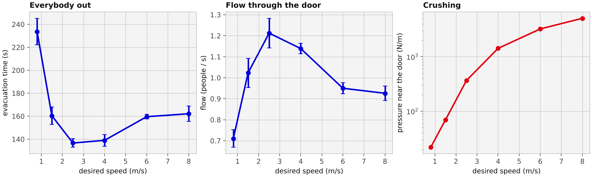
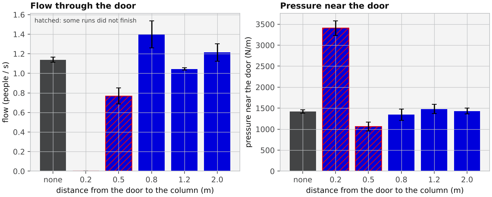

::: {.callout-tip}
## Optional extension

This page extends the [social force model](social-force.qmd). There, pedestrians avoid each other politely. Here the crowd is **in a hurry**, bodies touch, and a narrow door becomes a bottleneck. We ask two questions: does pushing harder get you out sooner, and can a column in front of the door help?
:::

When many people squeeze through a narrow opening, a few of them lean on each other and form an **arch** across the door. The arch blocks the exit until it breaks. Two counterintuitive claims come from this picture:

1. **Faster is slower.** If everybody pushes harder, the arches form more often and the flow through the door *drops* [@helbing2000simulating].
2. **A column in front of the door can help.** It takes some of the pressure off the people at the door and so makes the arches less likely.

Both claims have been tested, and the evidence is more mixed than the pictures suggest.

| Claim | System | What was found |
|---|---|---|
| Faster is slower | pedestrians (simulation) | the flow drops when the desired speed grows [@helbing2000simulating] |
| Faster is slower | people, sheep and grains (experiments) | the effect appears in all three [@pastor2015experimental] |
| A column helps | grains in a silo | a well-placed obstacle reduces clogging by about two orders of magnitude, best when its distance to the outlet is about the outlet size [@zuriguel2011silo; @lozano2012flow] |
| A column helps | sheep | the flow improved in two of three positions and got **worse** when the obstacle was too close to the door [@zuriguel2016effect] |
| A column helps | people (drills with up to about 180 people) | no measurable change of the flow rate, but the sideways rushes that can make people fall were weaker [@garcimartin2018redefining] |

The model on this page lets you explore why the answer can depend so much on the system.

## The model

We use the physics-based version of the social force model of @helbing2000simulating. Pedestrians are discs of radius $r_i \in [0.25, 0.35]$ m and mass $m = 80$ kg. The motion of pedestrian $i$ is

$$
m\,\frac{d\mathbf{v}_i}{dt} = m\,\frac{v^0 \mathbf{e}_i - \mathbf{v}_i}{\tau}
+ \sum_{j}\Big[A\,e^{(r_{ij}-d_{ij})/B} + k\,g(r_{ij}-d_{ij})\Big]\mathbf{n}_{ij}
+ \sum_{j}\kappa\,g(r_{ij}-d_{ij})\,(\Delta\mathbf{v}_{ji}\cdot\mathbf{t}_{ij})\,\mathbf{t}_{ij}
+ \text{(walls and column)}.
$$ {#eq-crowd-force}

Compare it with the [social force model](social-force.qmd):

- The first term is the **wish to move**: the pedestrian wants to walk with speed $v^0$ toward the exit and relaxes to it in a time $\tau = 0.5$ s. Here $v^0$ is the dial that says *how much in a hurry* the crowd is.
- The second term is the **social repulsion** $A e^{(r_{ij}-d_{ij})/B}$ with $A = 2000$ N and $B = 0.08$ m, plus a **body force** $k\,g(r_{ij}-d_{ij})$ that acts only when two discs overlap ($g(x) = x$ for $x > 0$, else 0). Here $r_{ij} = r_i + r_j$, $d_{ij}$ is the distance between the centres and $\mathbf{n}_{ij}$ points from $j$ to $i$. The stiffness is $k = 1.2 \times 10^5$ kg/s$^2$.
- The third term is **sliding friction** between bodies in contact, with $\kappa = 2.4 \times 10^5$ kg/(m s). It acts along the tangent $\mathbf{t}_{ij}$ and is what makes a crowd jam like a granular material.

Walls and the column act on a pedestrian in the same way as a fixed disc or line would.

**The setup.** A room of $12 \times 12$ m with one door of width 1 m in the bottom wall, and 150 pedestrians placed at random without overlap. Whoever crosses the door line has escaped. We measure:

- the **evacuation time**: when the last person crosses the door line;
- the **flow**: people per second through the door, measured between the 10th and the 90th percentile of the exits;
- the **pressure** on the people within 2 m of the door: the sum of the contact (body) forces on a person divided by the perimeter $2\pi r$, in N/m [@helbing2000simulating];
- the **pause**: the time since the last person crossed. We call a pause longer than 2 s an *arch*.

::: {.callout-note}
## Two numerical choices

1. **Time step.** The contact stiffness is large, so the time step is small: $\Delta t = 0.002$ s. We checked that $\Delta t = 0.001$ s gives the same statistics at twice the cost.
2. **The door jambs.** The exponential social force acts along wall *faces*. At the free ends of the wall, the two door jambs, only the contact force acts. Without this change, the two jambs together can repel a slow pedestrian more strongly than it pushes, and it stalls in the middle of the doorway. This is a modification of the published model that we found necessary at low desired speeds.
:::

## Explore the crowd

The figure is the same model, ported to JavaScript. People are coloured by the **pressure** they feel, from calm blue to red. A red **band** in the plot marks a pause longer than 2 s. The status line in the room tells you when an arch is blocking the door.

::: {.viz data-viz="crowd-exit"}
1. Press **Calm walk** (1.5 m/s) and restart. How long does the evacuation take, and what is the flow at the door? Then press **Panic** (6 m/s) and restart. What changes: the time, the pressure, the pauses?
2. Sweep the desired speed with the slider between 1 and 8 m/s, restarting each time. Where is the evacuation fastest? Is the best crowd the one that pushes hardest?
3. Set the **column distance** to 0.8 m and the speed to 4 m/s. Restart a few times with and without the column. Does the flow change, and does the pressure at the door change?
4. Move the column to 0.2 m and to 0.5 m from the door. What happens? Why?
5. Widen the door from 1.0 to 1.5 m. Does faster is slower survive?
:::

## Run it on your computer

From the repository root:

```bash
# the animation with sliders (IE dark theme)
python amlab/collective_motion/crowd_exit_animation.py

# options: light theme, panic, a column 0.8 m in front of the door
python amlab/collective_motion/crowd_exit_animation.py --theme light --v0 6 --column 0.8

# save a GIF or an MP4 instead of opening a window (MP4 needs ffmpeg)
python amlab/collective_motion/crowd_exit_animation.py --save exit.gif --frames 300 --v0 4

# self-test: four evacuations at different desired speeds, no graphics
python amlab/collective_motion/crowd_exit.py
```

In the window, the desired speed and the playback speed change live. The door width, the column distance and the number of people restart the evacuation. **Space** pauses. At the default playback speed of 4, an evacuation takes roughly half a minute to a minute of real time, depending on your computer. A smaller crowd (`--n 100`) is lighter, and a lower playback speed makes the window smoother.

## The code

`crowd_exit.py` has the whole model in one class, `CrowdSim`, and the parameters in a dataclass, `CrowdParams`. The most important idea is that only *near* pairs of pedestrians interact, so we find them with a KD-tree, the same one used in the Couzin code:

```python
pairs = cKDTree(pos).query_pairs(2 * p.r_max + self.CUTOFF, output_type="ndarray")
i, j = pairs[:, 0], pairs[:, 1]
dxy = pos[i] - pos[j]                        # from j to i
d = np.hypot(dxy[:, 0], dxy[:, 1])
n_vec = dxy / d[:, None]
f, body = self._contact(d, r[i] + r[j], n_vec, vel[j] - vel[i])
F[:, 0] += np.bincount(i, f[:, 0], n) - np.bincount(j, f[:, 0], n)   # Newton's third law
F[:, 1] += np.bincount(i, f[:, 1], n) - np.bincount(j, f[:, 1], n)
```

A short experiment of your own:

```python
from amlab.collective_motion.crowd_exit import CrowdParams, run_evacuation, sweep

r = run_evacuation(CrowdParams(v0=4.0), seed=0)
print(r["evac_time"], r["flow"], r["door_pressure"])

# faster is slower: 5 random rooms per speed (about 10 s per evacuation)
res = sweep("v0", [1.5, 2.5, 4.0, 6.0], n_seeds=5)
print(res["values"], res["evac_time"], res["flow"])

# the column: its distance from the door at a fixed speed
base = CrowdParams(v0=4.0, obstacle=True)
res = sweep("obs_gap", [0.8, 1.2, 2.0], base=base, n_seeds=5)
```

Runs that do not finish within `t_max` (300 s by default) are reported with `complete < 1`.

## Experiment 1: faster is slower

`run_experiments.py crowd` produces the figures below. It takes about 20 minutes (less on a fast computer), because every point is an average over 5 evacuations. Run it with `--seeds 3` for a faster draft.

{#fig-fis fig-alt="Three panels against the desired speed from 0.8 to 8 metres per second. Left: the evacuation time falls from about 234 seconds to a minimum of about 137 seconds near 2.5 metres per second and rises again to about 162 seconds. Middle: the flow rises to about 1.2 people per second near 2.5 metres per second and falls to about 0.93 at 8. Right: the pressure near the door grows from about 22 to about 5000 newtons per metre on a logarithmic axis."}

The curves have two regimes:

- **Slow crowds** (below about 2 m/s) are limited by how fast people *walk*. A faster wish to move means faster evacuation.
- **Fast crowds** (above about 3 m/s) are limited by the *door*. The evacuation takes longer again, from about 137 s at 2.5 m/s to about 162 s at 8 m/s: the flow drops by about a quarter. The pressure at the door grows by a factor of more than 200 over the whole range. That is the faster-is-slower effect [@helbing2000simulating].

The position of the minimum depends on the size of the room, the width of the door and the contact parameters. Do not read the number 2.5 m/s as a property of real crowds: read the model as a mechanism, not as a prediction.

## Experiment 2: a column in front of the door

We fix the crowd at $v^0 = 4$ m/s and compare the room without a column with a column of radius 0.5 m at several distances from the door (measured from the door line to the nearest point of the column).

{#fig-column fig-alt="Two bar charts for a room with no column and with the column at 0.2, 0.5, 0.8, 1.2 and 2.0 metres. The flow is highest for the column at 0.8 metres. Bars for 0.2 and 0.5 metres are hatched because some or all runs did not finish."}

Mean over 5 random rooms (± is the standard deviation between the rooms):

| Column distance | Flow (people/s) | Pressure near the door (N/m) | Everybody out within 300 s? |
|---|---|---|---|
| no column | $1.14 \pm 0.03$ | 1420 | yes |
| 0.2 m | fewer than 10 people got out | 3400 | no |
| 0.5 m | $0.77 \pm 0.08$ | 1060 | no |
| 0.8 m | $1.40 \pm 0.14$ | 1340 | yes |
| 1.2 m | $1.04 \pm 0.01$ | 1480 | yes |
| 2.0 m | $1.21 \pm 0.09$ | 1430 | yes |

- **Too close** (0.5 m or less): the column makes things *worse*. The space between the column and the door is narrower than a body, and the column itself becomes the bottleneck.
- **At 0.8 m** the flow is about 20% higher than without a column, and the evacuation is shorter (123 s against 139 s). This is a distance close to the width of the door, as in the silo experiments [@zuriguel2011silo].
- **At 1.2 m** the flow is *lower* than without a column, and at 2 m it is the same within the noise.
- The **pressure** near the door does not change much, except for the blocked cases. So in this model the benefit does not show up as a lower pressure within 2 m of the door. To test the idea that the column shields the door, measure the contact forces only on the people closest to it (`door_pressure(radius=1.0)`).

With only 5 rooms per point, differences smaller than about 0.1 people/s are not significant. Increase `--seeds` before you trust a small difference.

So the effect of the column depends strongly on its **position**, as in the silo and sheep experiments [@zuriguel2011silo; @zuriguel2016effect]. A common explanation is that the column takes the load of the people behind it, so that fewer arches form at the door, and that the people who go around it reach the door from the sides instead of head-on [@zuriguel2011silo]. The model reproduces the dependence on position. Whether it reproduces the *mechanism* is for you to find out.

::: {.callout-warning}
## The experiments with people did not find this

In the drills with people, the flow rate did **not** change measurably. The obstacle only made the sideways rushes weaker [@garcimartin2018redefining]. Our model is closer to the silo and the sheep than to those drills. Possible reasons, which the model can help to test but does not settle: people in a drill may push less than our discs do, and they avoid each other actively. Always ask whether the *conditions* of a simulation match those of the experiment before you compare them.
:::

::: {.callout-note}
## Exercise 1: how hard is the push?

At $v^0 = 6$ m/s, what is the force with which a pedestrian pushes when it is at rest, according to the first term of @eq-crowd-force? Compare it with the weight of a person of 80 kg.

:::

::: {.callout-tip collapse="true"}
## Solution

At rest ($\mathbf{v} = 0$) the wish-to-move term is $m v^0/\tau = 80 \times 6/0.5 = 960$ N. The weight is $80 \times 9.8 \approx 784$ N. So at 6 m/s every person pushes with a force larger than their own weight, and a crowd of such people transmits a large force through the bodies to the front rows. This is why the pressure grows so fast with the desired speed in @fig-fis.
:::

::: {.callout-note}
## Exercise 2: why a minimum?

Explain in two sentences why the evacuation time has a minimum as a function of the desired speed, using the words *walking* and *door*.

:::

::: {.callout-tip collapse="true"}
## Solution

At low speed the people need a long time to arrive and to move through the door one after the other, so the evacuation is limited by how fast they walk. At high speed they arrive quickly, but the pushing forms arches that block the door, so the evacuation is limited by how often the arches break. The best speed is where the two limits balance.
:::

::: {.callout-note}
## Exercise 3: a column that is too close

The door is 1 m wide and a person is 0.5 to 0.7 m wide. Why does a column placed 0.2 m from the door make things worse?

:::

::: {.callout-tip collapse="true"}
## Solution

At 0.2 m the space between the column and the door line is narrower than a body (0.5 to 0.7 m), so nobody can pass between them, and the people who get around the column still have to turn toward the door. The column itself becomes the bottleneck. The sheep experiment found the same: an obstacle too close to the door made the flow worse [@zuriguel2016effect].
:::

::: {.python-next}
**Build this in Python.** Option D of [Practice: Collective Motion](practice-collective-motion.qmd#option-d-faster-is-slower) asks you to write the evacuation model with contact forces, find the speed with the shortest evacuation time and test a column.
:::

## What this model does not do

- The pedestrians are **discs** with no vision and no strategy. Real people are not circular, can turn their shoulders, and avoid pushing when they can.
- The room is a square with a single door, and the people start at random positions. Real evacuations have corridors, stairs and smoke.
- The results come from **a few random rooms** for every point. The error bars in @fig-fis are the standard deviation over 5 runs. Differences smaller than that are not significant.
- The contact stiffness and the time step are chosen for speed. A much smaller time step gives the same statistics, but the very large pressures are only qualitative.
- The idea for this page came from a short video simulation. The effects it shows (arches, the column) are real and published, but the exact thresholds in the video (the gap between the tips of the obstacle, the angle of its faces) are not in the papers cited here, and we have not tested them.

## Going further

- **Obstacle shape.** Replace the circle by a wedge or a short wall, with the tip toward the crowd. Does a slanted face lead the people to the sides better?
- **A few pushers.** Give only 10% of the people a high desired speed. How many are needed to slow everybody down?
- **Arch statistics.** Collect the times between consecutive exits from many runs (`run_evacuation` returns them as `gaps`) and plot their distribution on a logarithmic scale. What share of the total time is spent in pauses longer than 2 s, and how does it change with the desired speed?
- **Granular flow.** Models of grains in a silo use the same kind of contact forces (stiffness and friction), with gravity in place of the wish to move. This is the system of the first experiments on obstacles [@zuriguel2011silo].
