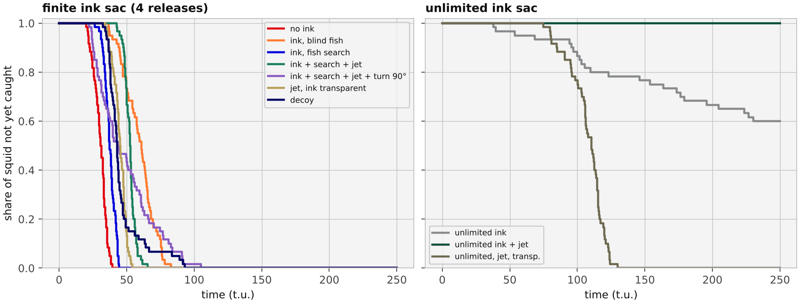

::: {.callout-tip}
## Optional extension

This page combines two ideas from earlier modules, **agents that move and interact** (Module 2) and **a field that spreads and fades** (Module 4). It extends the [confusion effect](../collective-behaviour/confusion-effect.qmd). There a school defends itself against one predator. Here the roles are reversed: **one prey, a squid, is hunted by a school of fish** and defends itself with a chemical and optical weapon. The question is: **can a squid defeat a whole school by hiding in its own ink, and does it help if the squid also decides where to go?**
:::

A squid cannot outswim a school of fast fish for long. It has one trick that the fish do not: it can release a cloud of ink and leave. The ink has been proposed to work in several ways, as a chemical irritant, as a decoy shaped like the squid (a *pseudomorph*), and as a **smoke screen** that hides the squid from the eyes of the predator [@derby2014cephalopod]. Experiments with live predators support at least the optical and the decoy effects: ink delayed food capture by French grunts [@wood2010caribbean], and the visual effect of squid ink delayed the approach of summer flounder [@derby2013ink].

We model only the **smoke screen**. The model has three ingredients that you know from earlier pages: agents that move and interact locally (the fish follow Vicsek-type rules, as in the [Vicsek model](../collective-behaviour/vicsek-model.qmd)), a field that changes in time (the ink, as in the [reaction-diffusion](../pattern-formation/reaction-diffusion.qmd) module) and a coupling between the two (the fish pursue the squid only as well as they can see it). Coupling moving agents to a field is a common modelling pattern. A related one is the chemotactic predator and prey of Sengupta, Kruppa and Löwen [@sengupta2011chemotactic], where each animal follows the gradient of a chemical released by the other.

::: {.callout-note}
## What is and is not claimed

This is a **teaching model**. The parameters are chosen so that the mechanisms are visible and are not fitted to squid data. In a first literature search I did not find a model that combines a single inking prey, a schooling predator and a concentration-dependent loss of vision, but a first search is not a proof of novelty. Treat the combination as a question worth exploring, not as an established result.
:::

## The model

Lengths are in body lengths (BL) and time in arbitrary time units (t.u.). All animals live on a periodic square of side $L = 40$ BL.

| Ingredient | Rule |
|---|---|
| **Fish** (predators) | Align with neighbours, move toward the school, keep a minimum distance, and **pursue the squid** with a weight that depends on how well they see it. A fish that loses the squid in the ink **searches**: it heads for the place where it last saw it. They are noticeably faster than the squid. |
| **Squid** (prey) | Cruises slowly. When the nearest fish comes within 8 BL it turns away and swims faster. If it still has ink and has not inked too recently, it releases a bolus at its position. Each release spends a share of the ink that is left in the sac. |
| **Squid decision** (optional) | After a release the squid commits for a short time to a heading, **straight away from the nearest fish turned by the escape angle $\varphi$ to a random side**, and jets at a multiple of its flight speed. $\varphi = 0$ and no jet is the squid without a decision. |
| **Ink** | A field $c$ on a $100 \times 100$ grid. In every step it spreads to the neighbouring cells, and cells with very little ink are reset to 0. The sac is **finite**: it starts full, and every release spends a share of what is left, so later clouds are thinner. |
| **Vision** | The pursuit weight of a fish is multiplied by the **transmission** along the line from the fish to the squid: the more ink on the way, the less it sees. |
| **Capture** | A fish within 0.8 BL of the squid catches it. A hunt that lasts 250 t.u. without a capture counts as an escape. |

### The ink: spread, dilute, disappear

The ink follows a simple local rule in every step. Each cell keeps a fraction $1 - s$ of its ink and gives $s/4$ to each of its four neighbours. Afterwards any cell with less than a threshold $\theta$ of ink is reset to exactly zero:

$$
c_{ij}' = (1 - s)\,c_{ij} + \frac{s}{4}\left(c_{i+1,j} + c_{i-1,j} + c_{i,j+1} + c_{i,j-1}\right),
\qquad
c_{ij}' \leftarrow 0 \ \text{ if } \ c_{ij}' < \theta .
$$ {#eq-spread}

With $s = 1/2$, half of the ink of a cell stays and half goes to its neighbours. The first part of the rule conserves the total amount of ink, and the second part removes it. A thick bolus (a large peak value) spreads farther and lasts longer before the threshold erases it, so the **thickness** of the ink is a parameter we can play with.

This rule is a discrete diffusion. Expanding it to second order in the grid spacing $\Delta x$ gives $c' - c \approx \tfrac{s}{4}\,\Delta x^2\,\nabla^2 c$ per step, which is the diffusion equation with an effective diffusion coefficient

$$
D_\text{eff} = \frac{s\,\Delta x^2}{4\,\Delta t_\text{ink}} .
$$ {#eq-deff}

With $s = 0.5$, $\Delta x = 0.4$ BL and three ink steps per time step of $0.12$ (so $\Delta t_\text{ink} = 0.04$) this is $D_\text{eff} = 0.5$ BL$^2$/t.u. The next figure shows one bolus spreading, and the numbers check @eq-deff: the variance of the cloud must grow as $\sigma^2(t) = \sigma_0^2 + 2 D_\text{eff}\, t$ while no cell is cut off.

```{python}
#| label: fig-ink-spread
#| fig-cap: "One bolus of ink after 0.1, 3, 10 and 30 time units. The cloud spreads and its peak falls, and the cut-off gives it a sharp edge. Each panel has its own colour scale. The numbers above each panel are the peak amount of ink in a cell and the share of the released ink still in the grid."
#| fig-alt: "Four heat maps of an ink cloud around the same point. The cloud widens from a small dark disc to a faint disc about thirteen body lengths across, while the peak falls from 2.6 to 0.05 and the ink left falls from 100 percent to 22 percent."
import numpy as np
import matplotlib.pyplot as plt
from dataclasses import replace
from amlab.collective_motion.squid_ink import InkParams, SquidInkSimulation

p = InkParams()
sim = SquidInkSimulation(p, seed=1)
sim.squid = np.array([20.0, 20.0])
sim._release_ink()
total0 = sim.ink.sum()

snapshots = {}
for step in range(1, 251):
    sim._spread_ink()
    if step in (1, 25, 83, 250):
        snapshots[step] = sim.ink.copy()

fig, axs = plt.subplots(1, 4, figsize=(11, 3.1), constrained_layout=True)
half = int(15 / sim.dx)
for ax, (step, ink) in zip(axs, snapshots.items()):
    window = ink[50 - half : 50 + half, 50 - half : 50 + half]
    ax.imshow(window, origin="lower", cmap="Blues", vmin=0, vmax=window.max(),
              extent=(-15, 15, -15, 15))
    ax.set_title(f"t = {step * p.dt:.1f}\npeak {ink.max():.2f}, ink left {100 * ink.sum() / total0:.0f} %", fontsize=9)
    ax.set_xticks([-10, 0, 10])
    ax.set_yticks([-10, 0, 10])
axs[0].set_ylabel("BL")
plt.show()

# check of the effective diffusion coefficient (no cut-off)
free = SquidInkSimulation(replace(p, threshold=0.0), seed=1)
free.squid = np.array([20.0, 20.0])
free._release_ink()
x = np.arange(p.grid) * free.dx

def variance_x(s):
    w = s.ink.sum(axis=0)
    w = w / w.sum()
    mu = (w * x).sum()
    return ((x - mu) ** 2 * w).sum()

v0 = variance_x(free)
for _ in range(250):
    free._spread_ink()
t = 250 * p.dt
d_eff = p.spread * free.dx**2 / (4 * p.dt / p.ink_steps)
print(f"D_eff = {d_eff:.2f}; variance after t = {t:.0f}: measured {variance_x(free):.2f}, predicted {v0 + 2 * d_eff * t:.2f}")
```

### Vision: a Beer-Lambert law

Light that travels through a medium that absorbs it fades exponentially with the amount of absorber on the way. For the fish $i$ at distance $d_i$ from the squid, let $\bar c_i$ be the mean ink concentration along the straight line between them. The transmission is

$$
\tau_i = \exp\!\left[-\left(a + \kappa\, \bar c_i\right) d_i\right],
$$ {#eq-transmission}

where $\kappa$ is the **opacity** of the ink and $a = 0.05$ BL$^{-1}$ is the small absorption of clear water, so that even without ink a distant squid is a little harder to see. In a dense cloud $\tau_i \approx 0$. The heading of the fish is steered by

$$
\mathbf{v}_i = w_\text{a}\,\mathbf{a}_i + w_\text{c}\,\mathbf{c}_i + w_\text{s}\,\mathbf{s}_i + w_\text{p}\,\tau_i\,\hat{\mathbf{p}}_i ,
$$ {#eq-pursuit}

where $\mathbf{a}_i$, $\mathbf{c}_i$ and $\mathbf{s}_i$ are the alignment, cohesion and separation terms of the school, and $\hat{\mathbf{p}}_i$ is the unit vector toward the squid. A fish that sees the squid (transmission above 0.2) remembers its position. If it loses the squid, it replaces $\hat{\mathbf{p}}_i$ by the direction of that **last-seen place** and uses a fixed weight $w_\text{search} = 0.8$ instead of $\tau_i$, until it gets within 1.5 BL of the place and gives up. Switch this off (`search=False`) and a fish that loses the squid simply drifts on with the school. As an alternative tactic, `decoy=True` makes the fish chase the **densest ink blob** within 10 BL: the ink is then bait and not smoke.

| Parameter | Value | | Parameter | Value |
|---|---|---|---|---|
| fish speed | 0.70 | | squid speed (cruise, flight) | 0.30, 0.45 |
| turning rate of a fish | 0.20 rad/step | | flight distance | 8 BL |
| weights $w_\text{a}, w_\text{c}, w_\text{s}, w_\text{p}$ | 1.1, 0.35, 1.4, 1.9 | | minimum time between releases | 5 t.u. |
| spreading fraction $s$ | 0.5 | | ink threshold $\theta$ | 0.002 |
| ink steps per time step | 3 | | bolus peak (fixed) | 3 |
| ink strength (opacity) $\kappa$ | 2.8 (default) | | time step $\Delta t$ | 0.12 |
| clear-water absorption $a$ | 0.05 | | share of the remaining ink used per release | 0.6 (default) |
| ink sac is empty below | 5 % of a full sac | | search weight $w_\text{search}$ | 0.8 |
| jet speed factor $\beta$ | 1 (no jet); 2 in the decision experiments | | jet time $\tau_\text{j}$ | 2 t.u. |
| escape angle $\varphi$ | 0 (default) | | hiding time (optional) | 0 |
| start | random school position and squid heading in every hunt | | | |

## A decision for the squid

So far the squid has no decision system. It runs directly away from the nearest fish and the ink does the rest. This is a weak squid: it never uses the cloud. We give it the smallest decision that can be explained in one sentence:

> **After inking, the squid turns by an angle $\varphi$ away from its flight line and jets for a short time.**

Let $t_r$ be the time of a release and $\theta_\text{away}$ the heading straight away from the nearest fish at that moment. For $t_r < t \le t_r + \tau_\text{j}$ the squid steers to the heading and moves with the speed

$$
\theta^\ast = \theta_\text{away} + \sigma\,\varphi ,
\qquad
v = \beta\, v_\text{flee} ,
\qquad \sigma = \pm 1 \text{ with equal probability,}
$$ {#eq-decision}

and afterwards it flees from the nearest fish again, as before. The side $\sigma$ is a coin toss. There are two dials, the **escape angle** $\varphi$ (`escape_angle`, in degrees) and the **jet** (`jet_boost` $=\beta$ and `jet_time` $=\tau_\text{j}$). With $\varphi = 0$ and $\beta = 1$ the squid is the one of the first part of this page, and these are the defaults of the code. The experiments below switch the jet on with $\beta = 2$ and $\tau_\text{j} = 2$ t.u. (speed 0.90, faster than the fish at 0.70). A second option, `hide_time`, makes the squid hold still inside its own cloud; it is tested below and does not help.

The idea behind the angle is that a squid that leaves the cloud sideways should surprise fish that are heading for the place where they last saw it. The experiment decides whether the idea works.

```{python}
#| label: tbl-angle
import csv
import numpy as np

rows = list(csv.DictReader(open("data/squid_ink_sweeps.csv")))

def hunts(sweep, value):
    """seed -> (time, captured) for one setting."""
    return {int(r["seed"]): (float(r["time"]), float(r["captured"]))
            for r in rows if r["sweep"] == sweep and abs(float(r["value"]) - value) < 1e-9}

print("escape angle: mean time to capture +- 95% CI, share not caught by 250 t.u. (jet x2, 60 paired hunts)")
for name, label in [("angle_blind", "blind fish"), ("angle_search", "searching fish")]:
    ref = hunts(name, 0)
    for a in (0, 30, 60, 90, 120, 150, 180):
        h = hunts(name, a)
        t = np.array([h[k][0] for k in sorted(h)])
        d = np.array([h[k][0] - ref[k][0] for k in sorted(h)])      # paired by seed
        unc = int(sum(1 - h[k][1] for k in h))
        print(f"{label:15s} angle {a:3d}: {t.mean():5.1f} +- {1.96 * t.std(ddof=1) / np.sqrt(len(t)):4.1f}"
              f"   change against 0 degrees {d.mean():6.1f} +- {1.96 * d.std(ddof=1) / np.sqrt(len(d)):4.1f}   not caught {unc}/{len(h)}")
```

{#fig-squid-decision fig-alt="Three panels. Left: time to capture falls as the escape angle grows from 0 to 180 degrees. For searching fish it goes from 52 at 0 degrees to 49 at 90, 38 at 120 and 12 at 180, below the 30 of a squid without ink. For blind fish it goes from 68 to 24. Middle: five similar falling curves for different fish and squid speeds; each is highest or flat at 0 to 60 degrees and drops steeply beyond 120 degrees. Right: time rises from 37 to 60 as the jet factor goes from 1 to 3 with ink, and from 30 to 53 with transparent ink, so the two lines stay about 7 time units apart."}

The answer is **no**. Turning away from the flight line never helped, for blind or for searching fish. The best angle is 0, and angles up to 60 degrees cost nothing measurable. Beyond 90 degrees the squid loses time, and at 150 or 180 degrees it swims toward the fish, so that searching fish catch it earlier than a squid without any ink. The middle panel shows that this is not a tuning accident: with faster or slower fish and with a faster or slower squid the curve is always flat or falling, and no angle beats 0 by more than the confidence interval.

Two things explain it. The first is geometry: the fish close the gap at the difference of the speeds, and a squid that leaves the line spends only the fraction $\cos\varphi$ of its speed on increasing the distance. During the jet it keeps gaining on the fish only while $\beta\, v_\text{flee} \cos\varphi > v_\text{fish}$, that is $\cos\varphi > 0.70/0.90$ or $\varphi < 39^\circ$. The second is optics: the fish approach along the line to the squid, so a squid that flees straight away stays **behind** the cloud on every sightline, whereas a squid that steps aside opens a clear line of sight within a few time units. Straight flight is the best use of the cloud.

What the decision system does buy is the **jet**. The jet is worth about 15 t.u. for searching fish (37.5 to 52.4 t.u.), twice the 7 t.u. that the ink alone is worth, and the two add up. A first-order estimate shows that this is bookkeeping and not cleverness: in one jet the squid travels $(\beta - 1)\,v_\text{flee}\,\tau_\text{j} = 0.9$ BL farther than in plain flight, four releases give 3.6 BL, and the fish close a gap at $0.70 - 0.45 = 0.25$ BL per t.u., so the capture is delayed by $3.6 / 0.25 \approx 14$ t.u. The simulation gives 14.9 t.u. The right panel of @fig-squid-decision shows that the ink contributes the same 7 t.u. at every jet speed.

## Explore the hunt

The figure is the same model, ported to JavaScript. The camera follows the squid by default; the **Camera** button fixes the view on the whole sea. Fish are red arrows: a **filled** arrow can still see the squid, a **hollow** arrow has lost it in the ink. A white ring around the squid means that it has just inked and must wait before it can ink again; the label in the corner shows how much of the ink sac is left, and the squid itself turns from green to grey as the sac empties. **Recharge ink** refills it to 100%. The **Escape angle** slider and the **Squid jet** button give the squid its decision: with the jet on, the label in the corner shows JET while the squid is bursting. The plot shows the mean visibility of the squid and the distance of the closest fish.

::: {.viz data-viz="squid-ink"}
1. Press **Ink: off** and watch about ten hunts. How long does the squid survive? Then switch the ink on again and compare the capture probability shown in the readout.
2. Set the **ink strength** $\kappa$ to 0. Why does a cloud that does not absorb light give no protection, although the squid still releases ink?
3. Set **ink used per release** to 0.2 and then to 0.8. With 0.2 the squid releases many thin clouds, with 0.8 it releases two thick ones and then runs dry. Which survives longer? Then set it to 0 (unlimited ink). Is that realistic? Press **Recharge ink** during a hunt: how much does one refill buy?
4. Raise the **ink strength** from 1 to 8. Does the benefit keep growing, or does it flatten? (The page has one strength dial and not two. Exercise 3 explains why.)
5. Compare a school of 12 with a school of 40 at the default ink. Does a bigger school find the squid more easily?
6. Switch **Fish search** off and watch ten hunts, then on again. What does the ink do to a fish that remembers where the squid was? Then try **Decoy: on**: why is bait worse for the squid than smoke?
7. Press **Squid jet: on** with the escape angle at 0 and watch ten hunts: how much longer does the squid last? Then raise the **escape angle** to 90 and to 150. Where does the squid go when it turns, and why do the fish find it sooner?
:::

## Run it on your computer

From the repository root:

```bash
# the animation with sliders (IE dark theme)
python amlab/collective_motion/squid_ink_animation.py

# options: light theme, a bigger school, stronger ink, a control without ink
python amlab/collective_motion/squid_ink_animation.py --theme light --fish 40 --kappa 5
python amlab/collective_motion/squid_ink_animation.py --no-ink

# the squid's decision: a jet twice as fast, with and without a turn of 90 degrees
python amlab/collective_motion/squid_ink_animation.py --jet 2
python amlab/collective_motion/squid_ink_animation.py --jet 2 --escape-angle 90

# save a GIF or an MP4 instead of opening a window (MP4 needs ffmpeg)
python amlab/collective_motion/squid_ink_animation.py --save squid-ink.gif --frames 300

# self-test and a short comparison with and without ink, without graphics
python amlab/collective_motion/squid_ink.py
```

In the window the sliders change the ink strength and the share of ink used per release live (the jet and the escape angle are set on the command line), and the school size restarts the hunt. **Ink on/off** switches the ink off, **Camera** (or **C**) switches between following the squid and a fixed view of the whole sea, **New hunt** starts again and **Space** pauses. The animation redraws only the moving parts, which keeps it smooth; use `--speed 1` on a slow computer.

## How the code works

The model is in `amlab/collective_motion/squid_ink.py`. The ink rule of @eq-spread is four array shifts:

```python
nb = np.roll(c, 1, 0) + np.roll(c, -1, 0) + np.roll(c, 1, 1) + np.roll(c, -1, 1)
c = (1.0 - spread) * c + (spread / 4.0) * nb      # keep a fraction, give the rest away
c[c < threshold] = 0.0                            # the cut-off
```

and the transmission of @eq-transmission samples the field at points along each line of sight:

```python
rays = wrap_delta(squid - fish, domain)                    # fish -> squid, on the torus
points = fish[:, None, :] + rays[:, None, :] * fractions[None, :, None]
mean_c = sample_ink(points).mean(axis=1)                   # mean ink on each sightline
tau = np.exp(-kappa * mean_c * distance)
```

`self_test()` checks that the same seed gives the same hunt, that the spreading rule conserves ink when the threshold is 0, that it is symmetric, that a cloud disappears, that the transmission falls as the opacity grows, that the squid never releases ink twice within the minimum interval, that the ink sac only ever empties, and that the decision system leaves the old model untouched at its defaults, turns by exactly the escape angle to a random side, jets at the boosted speed and holds still when hiding. A second pair of programs, `tests/squid_parity.py` and `tests/squid_parity.js`, runs the Python and the JavaScript model with the same four settings so that you can compare the two ports; the means agree within about 3 t.u.

To run your own experiment:

```python
from dataclasses import replace
from amlab.collective_motion.squid_ink import InkParams, hunt, sweep

res = sweep("kappa", [0.0, 1.0, 3.0], base=InkParams(), n_seeds=10, t_max=250.0)
print(res["values"], res["capture_prob"])

# the same sweep for a squid that jets twice as fast after every release
res = sweep("kappa", [0.0, 1.0, 3.0], base=InkParams(jet_boost=2.0), n_seeds=10, t_max=250.0)
print(res["values"], res["mean_time"])
```

`sweep` runs `n_seeds` independent hunts for every value and returns the fraction in which the squid was caught within `t_max`. The next chunk compares a squid without ink, with ink and blind fish, and with ink and searching fish on six random hunts.

```{python}
#| label: tbl-ink-vs-none
import numpy as np
from dataclasses import replace
from amlab.collective_motion.squid_ink import InkParams, hunt

base = InkParams()
for label, par in [("no ink", replace(base, ink=False)), ("blind fish", replace(base, search=False)), ("searching", base)]:
    res = [hunt(par, seed, t_max=250.0) for seed in range(6)]
    caught = int(sum(r["captured"] for r in res))
    print(f"{label:10s} caught {caught} of 6 hunts, "
          f"mean time {np.mean([r['time'] for r in res]):5.1f}, "
          f"mean ink releases {np.mean([r['releases'] for r in res]):4.1f}")
```

## Experiment: how much does the ink help?

`run_experiments.py squid` reproduces the figures below (about 20 minutes on two processor cores). Every hunt starts from a random position of the school and a random heading of the squid, lasts at most 250 t.u. and ends at the capture. Each setting has **60 independent hunts**, and settings that are compared use the **same 60 random starts** (paired seeds). The line is the mean time to capture, the band is a 95% confidence interval for the mean, and the dashed line is the same hunt without ink. Every single hunt is saved in `data/squid_ink_sweeps.csv`.

{#fig-squid-sweeps fig-alt="Four panels of mean time to capture in time units. Top, bars: no ink about 30, ink with blind fish about 59, ink with fish that search about 37, decoy about 47, ink with search and jet about 52, with jet and a 90 degree turn about 49, jet with transparent ink about 45, unlimited ink about 203 with 24 of 60 squid caught, unlimited ink with jet 250 with none of 60 caught. Bottom left: the time rises slowly from 30 at zero opacity to 44 at opacity 8. Bottom middle: it falls from 90 to 35 as the share of ink used per release goes from 0.2 to 0.8. Bottom right: it falls from 50 to 34 as the school grows from 8 to 60."}

{#fig-squid-survival fig-alt="Two panels of falling step curves. Left, finite sac: no ink falls first, between 20 and 40 time units, then ink with searching fish, finishing by 45; jet with transparent ink by 65; ink with search and jet by 65 to 70; decoy, ink with blind fish and the jet with a turn by 85 to 105. Every curve reaches zero. Right, unlimited sac: without a jet the curve falls to 0.6 and stays; with a jet and real ink it stays at 1.0, so no squid is caught in 250 time units; with a jet and transparent ink it falls between 80 and 130 time units to zero."}

What the figures show:

- **Search takes most of the ink's benefit away.** Blind fish need 59 t.u. on average, against 30 without ink. Fish that remember where they saw the squid need only 37.5 t.u. The ink delays the capture by about 7 t.u. in that case, not by 29. The ink works well only against fish that forget.
- **Bait is worse than smoke.** The decoy tactic (47 t.u.) is faster than blind fish (59 t.u.), because the squid releases ink at its own position, so the fish are led straight to it. A real pseudomorph is released away from the squid while the animal jets off in another direction. The squid's decision above turns the animal, not the bait, and it did not help; a released-away decoy is still not modelled.
- **Opacity gives a slow gain.** With search on, the mean time rises from 30 at $\kappa = 0$ to 44 at $\kappa = 8$. There is no sharp threshold.
- **Spending the sac in many small clouds is better than in two large ones**: the mean time falls from 90 t.u. when the squid uses 20% of what is left per release (13 releases on average) to 35 t.u. when it uses 80% (2 releases). With the default 60% there are always 4 releases. That number follows from the arithmetic of the sac ($0.4^4 = 0.026$ is below the empty level 0.05) and is not a finding.
- **Bigger schools find the squid sooner** (50 t.u. for 8 fish, 34 for 60), with diminishing returns.
- **Unlimited ink is a different model.** With an endless supply (23 releases on average) 36 of 60 squid were never caught within 250 t.u., and the mean of 203 t.u. is cut off at 250, so it is too low. The survival curve is the honest way to show it. The limited sac turns an escape into a delay.
- **The jet is worth more than the ink, and the ink still adds about 7 t.u.** Searching fish catch a squid with the jet (speed factor 2, 2 t.u.) after 52.4 t.u. (95% CI 51.3 to 53.5), against 37.5 t.u. without it. If the ink is transparent ($\kappa = 0$) but the squid still jets, the capture takes 44.9 t.u., so the ink adds 7.5 t.u. (paired, $\pm$ 1.2) with the jet and 7.2 t.u. ($\pm$ 1.2) without it. A faster jet delays the capture more (45.5, 52.4 and 60.0 t.u. for factors 1.5, 2 and 3), and so does a longer one (45.6, 52.4 and 62.3 t.u. for 1, 2 and 4 t.u.), but the ink stays a second-order effect.
- **Turning sideways does not help; the best angle is 0.** For searching fish the mean time is 52.4, 51.5, 49.4 and 48.9 t.u. at 0, 30, 60 and 90 degrees (the paired changes against 0 degrees are $-0.9 \pm 1.3$, $-3.0 \pm 2.7$ and $-3.5 \pm 5.5$ t.u.), 38.4 at 120 and 18.1 and 12.3 at 150 and 180 degrees. For blind fish the values are 67.6 at 0 degrees and 24.5 at 180. Fish speeds of 0.6 and 0.8 and squid flight speeds of 0.35 and 0.55 give the same picture, with a flat curve up to 90 degrees at the two weakest settings (fish 0.8, squid 0.35). A first idea, to hide by turning sideways, is refuted by the model.
- **Hiding in the cloud is worse.** If the squid holds still after inking, searching fish catch it after 20.3, 14.4 and 12.8 t.u. for 2, 4 and 8 t.u. of hiding, against 37.5 without. The searching fish head for the place where they last saw the squid, which is where it hides.
- **With the decision, the squid is still caught, except when its ink never runs out.** With the finite sac every one of the 60 squid is caught in every setting (jet, any angle, blind or searching fish), the longest hunt of the default jet setting lasting 65 t.u. A larger sac helps: if the squid spends 20% of the remaining ink per release (14 releases) and jets, the mean time is 122.6 t.u., of which the ink accounts for 40.3 t.u. ($\pm$ 4.5) against the transparent control, but all squid are still caught (longest hunt 193 t.u.). Only with an **unlimited** sac and the jet are **all 60 squid never caught** in 250 t.u. The control with transparent ink and the same jet is caught after 107.3 t.u. on average, all 60 within 130 t.u. The ink then decides between escape and capture, but this needs about 26 releases, which no real sac allows.
- **Two dials, one effect.** The ink absorbs through the product of opacity and concentration, and a thicker bolus has a higher concentration. At the same product $\kappa \times$ thickness $= 8.4$ the mean time is 39, 37.5 and 36 t.u. for $\kappa = 1.4$, 2.8 and 8.4. Compare this with the 14 t.u. range of the opacity curve itself.

```{python}
#| label: tbl-ink-product
import csv
import numpy as np

rows = list(csv.DictReader(open("data/squid_ink_sweeps.csv")))
for kappa in (1.4, 2.8, 8.4):
    t = np.array([float(r["time"]) for r in rows if r["sweep"] == "product" and float(r["value"]) == kappa])
    print(f"kappa = {kappa:3.1f}, thickness = {8.4 / kappa:3.1f}: mean time {t.mean():5.1f} +- {1.96 * t.std(ddof=1) / np.sqrt(len(t)):3.1f}")
```

::: {.callout-note}
## Exercise 1: a cloud that does not absorb

With $\kappa = 0$ the squid still releases ink, and the cloud spreads exactly as before. Why does the squid get no protection? What does the figure say about the **cost** of releasing ink in the model?

:::

::: {.callout-tip collapse="true"}
## Solution

The ink acts only through the transmission $\tau = \exp[-(a + \kappa \bar c) d]$ of @eq-transmission. At $\kappa = 0$ only the weak clear-water term $a$ is left, whatever the concentration, so the fish pursue at full weight and the capture probability equals that of a squid without ink. The bottom-left panel of the figure and the unlimited-ink control show what ink costs in the model: a finite sac. With unlimited ink 36 of 60 squid are never caught within 250 t.u.; with the realistic sac every one is caught.
:::

::: {.callout-note}
## Exercise 2: the diffusion coefficient of the rule

Use the expansion of @eq-spread to derive @eq-deff. Then compute how long it takes the variance of a cloud to reach 36 BL$^2$ ($\sigma = 6$ BL) from an initial 0.8 BL$^2$.

:::

::: {.callout-tip collapse="true"}
## Solution

A cell gets $\tfrac{s}{4}$ of the ink of each neighbour and keeps $1 - s$, so $c_{ij}' - c_{ij} = \tfrac{s}{4}\,(c_{i+1,j} + c_{i-1,j} + c_{i,j+1} + c_{i,j-1} - 4 c_{ij})$. The bracket is $\Delta x^2\,\nabla^2 c$ to leading order, so one step changes $c$ by $\tfrac{s}{4}\Delta x^2\,\nabla^2 c$. Dividing by the duration $\Delta t_\text{ink}$ of the step gives $\partial_t c = D_\text{eff}\,\nabla^2 c$ with $D_\text{eff} = s\,\Delta x^2 / (4\,\Delta t_\text{ink})$. In one dimension the variance of a diffusing cloud grows as $\sigma^2 = \sigma_0^2 + 2 D_\text{eff}\,t$, so $t = (36 - 0.8) / (2 \times 0.5) = 35.2$ t.u. The cut-off makes the real cloud smaller than this and finally erases it.
:::

::: {.callout-note}
## Exercise 3: two dials, one effect

The model has two ways to make the ink stronger: the opacity $\kappa$ and the thickness of the bolus. The output of @tbl-ink-product shows that they give nearly the same capture time when their product is fixed, which is why the page offers a single **ink strength** slider (the opacity; the bolus thickness is fixed at 3). Use @eq-transmission to explain why, and say what small effect still separates the two.

:::

::: {.callout-tip collapse="true"}
## Solution

The transmission depends only on the product $\kappa\,\bar c\,d$. The spreading rule is linear, so a bolus that is $k$ times thicker has $k$ times the concentration everywhere (until the cut-off removes the faint edge), and multiplying $\kappa$ by $k$ does the same to the optical depth. What separates the two dials is the cut-off $\theta$: a thick cloud keeps cells above $\theta$ for longer, so it is a little wider and lasts longer than a thin cloud with a higher opacity.
:::

::: {.callout-note}
## Exercise 4: why does turning sideways fail?

Use @eq-decision and the speeds of the model (fish 0.70, squid flight 0.45, jet factor 2). (a) During the jet, the squid gains distance on a fish that chases it directly only while the radial part of its speed exceeds the fish's speed. For which escape angles does this hold? (b) Show that a jet at $\varphi = 0$ delays the capture by about $n\,(\beta - 1)\,v_\text{flee}\,\tau_\text{j} / (v_\text{fish} - v_\text{flee})$ for $n$ releases, and compare with the 14.9 t.u. of the simulation. (c) Use the optics of @eq-transmission to explain why, in addition, the angle should be small.

:::

::: {.callout-tip collapse="true"}
## Solution

(a) The jet has speed $\beta v_\text{flee} = 0.90$ and the radial part is $0.90\cos\varphi$. It exceeds $0.70$ when $\cos\varphi > 0.778$, so $\varphi < 39^\circ$. Beyond that angle the fish gain even during the jet. (b) One jet covers $\beta v_\text{flee}\tau_\text{j} = 1.8$ BL instead of $v_\text{flee}\tau_\text{j} = 0.9$ BL in plain flight, which is $0.9$ BL more. Four releases give $3.6$ BL. In plain flight the gap shrinks by $0.70 - 0.45 = 0.25$ BL per t.u., so the extra distance is worth $3.6 / 0.25 = 14.4$ t.u. The simulation gives $14.9 \pm 0.7$ t.u., so the estimate is good; it ignores that the fish do not chase along a perfectly straight line. (c) A fish that chases the squid sees it along the line fish-to-squid. The bolus sits at the release point on that line, so a squid that flees straight away stays behind the cloud and $\bar c\,d$ is large. A squid that leaves by a large angle has a clear line of sight after a few time units, so $\tau \to e^{-a d}$ and the cloud no longer matters.
:::

::: {.callout-note}
## Exercise 5: does the ink matter once the squid decides?

Use the numbers of the results: 37.5 t.u. (ink, search), 44.9 t.u. (jet, transparent ink) and 52.4 t.u. (jet, ink), and 30.3 t.u. (no ink). How much is the ink worth with and without the jet? How much is the jet worth? Why is a control with transparent ink, and not the squid without ink, the right comparison for the ink once the squid jets? Finally, why does an unlimited sac change the conclusion, and is that a result about squid?

:::

::: {.callout-tip collapse="true"}
## Solution

Without the jet the ink is worth $37.5 - 30.3 = 7.2$ t.u. (the jet-free control with $\kappa = 0$ is the no-ink time of the opacity curve). With the jet it is worth $52.4 - 44.9 = 7.5$ t.u. The jet is worth $52.4 - 37.5 = 14.9$ t.u. with ink and $44.9 - 30.3 = 14.6$ t.u. with transparent ink, so the effects are additive. A squid without ink cannot trigger the jet in the model, because the jet is tied to the release; a squid that inks with a transparent cloud has the same jet and the same cost, and differs only in the optics, so the difference isolates the **ink**. With an unlimited sac the squid can jet every 5 t.u. for ever and the cloud blocks the line of sight each time, so none of 60 squid is caught, while the transparent control is caught after about 107 t.u. This shows how strongly the conclusion depends on the sac, which the biology says is finite and takes about a month to refill, and it says nothing quantitative about real squid.
:::

::: {.python-next}
**Build this in Python.** Use `sweep` to vary the **spreading fraction** `spread` of @eq-spread. Does a wider, thinner cloud or a compact, dense one hide the squid better, for the same amount of ink? Then change the code so that the squid releases the decoy away from itself. Does a decoy that is released *away* from the squid (while the squid jets off the other way) help more than a smoke screen alone? Finally, make the escape side non-random: let the squid turn to the side with less ink on it, or away from the side where more fish are. Does a smarter side change the verdict that the best escape angle is 0?
:::

## Biological reality check

How well does the model match what is known about cephalopod inking? The points below separate what the model keeps from what it leaves out.

**What matches.**

- *Ink delays, it does not guarantee escape.* Live predators were slowed, not stopped, by ink [@wood2010caribbean; @derby2013ink], and Derby's review lists decoy, smoke screen and chemical effects as complementary roles [@derby2014cephalopod]. Against fish that forget, our squid is delayed by about a factor of two; against fish that search, much less.
- *The ink sac is finite and refills slowly.* In the cuttlefish *Sepia pharaonis* a full sac held about 765 mg of ink, and three inkings in a row released about 498, 178 and 38 mg; refilling took about 30 days [@jiang2019continuous]. Each release therefore spent roughly half or more of what was left, which is the rule of our model with a share of 0.6 per release. The default value is a round number inspired by these data, not a fit.
- *Spreading and dilution.* A real cloud expands and thins out in seconds to minutes, and a **smoke screen** and a **pseudomorph** (a compact, squid-sized blob of mucus-rich ink) are different tactics [@derby2014cephalopod]. The model has only the first.

**What is simplified or missing.**

- *The squid's decision is fixed and simple.* Real cephalopods often blanch, change colour and jet away *in the shadow of the cloud*, so the predator searches the wrong place. In the model the squid jets at a fixed speed for a fixed time on a fixed heading, and the fish lose it only because the cloud blocks the line of sight. A turn of the jet away from the cloud did not help in this model, which does not show that real squid gain nothing from it: the model has no colour change, no flow wake and no far away.
- *Vision is the only channel.* Fish also sense the pressure and flow wake of a jetting squid with the lateral line, and the ink has chemical effects on taste and smell [@derby2014cephalopod]. Both are ignored. This makes the model pessimistic for the fish side in one respect and optimistic in another, and we do not know which wins.
- *The box has no far away.* On a periodic square the squid cannot escape by distance, so ink can only delay the end. In open water a squid that breaks the line of sight may simply never be found.
- *Fish and squid speeds are chosen, not measured.* The fish are faster than the squid by assumption; the result depends on this ratio.
- *Ink is released as a Gaussian blob at rest.* In reality it is ejected in a jet, so the first shape of the cloud is set by the water flow.

The honest summary is this: the model captures the *logic* of a finite, optical smoke screen, and its qualitative message (ink buys time, and how the sac is spent matters) is consistent with the experiments cited. It does not support quantitative statements about real squid.

## Waves instead of ink

Fish and other aquatic animals do not rely on sight alone. A predator that moves through water disturbs it, and other animals can sense the disturbance with mechanoreceptors: copepods detect the flow produced by an approaching fish and escape in a direction away from it [@tuttle2019going], and killifish use a hydrodynamic sensory antenna to hunt at night [@schwarz2011hydrodynamic]. This suggests a different field-plus-agents model. A moving predator produces a damped flow field. The prey estimates the direction of the predator from a local spatial gradient of that field, and the school changes its motion in response. The field could be a diffusion-like decay, as here, or a wave equation with a propagation speed and a damping that are separate from the local response of the receptor.

This is a better-grounded use of the word **wave** than forcing a chemical Turing pattern onto squid ink: the ink field here only spreads and fades, and it cannot produce a traveling or a self-organized pattern. A pattern-forming ink would need a reaction term, which the real ink does not have.

## What this model does not do

- It is a **teaching model**. The parameters are not fitted to data, and the numbers in @fig-squid-sweeps should not be read as predictions for real squid.
- The ink supply is finite, but the refill is not modelled (a real sac needs about a month) and the ink has chemical effects (irritation, disruption of smell) that we do not model.
- The squid's strategy is minimal. It jets after inking and may turn by a fixed angle, but it does not look at the cloud, does not adapt to what the fish do, does not blanch and does not release a decoy away from itself. The jet speed factor (2) and the jet time (2 t.u.) were chosen, not measured.
- The fish see the squid through a single number, the transmission of the line between them. Real vision is limited by contrast, by the angle and by the size of the target.
- The ink spreads by a diffusion-like rule with a **constant** coefficient. Real ink is mixed by turbulence and by the jet, and turbulent spreading speeds up as the cloud grows. There is no current. The cut-off also deletes ink (about 78% of it within 30 t.u.), so it acts as a sink and not only as dilution.
- The fish search is a simple rule (go to the last-seen place and give up on arrival). Real predators use the lateral line, smell and memory in more complicated ways, and the fish here follow Vicsek-type rules, not the zonal rules of the [Couzin model](../collective-behaviour/couzin-model.qmd). A trial with Couzin zones gave a longer delay (about 2.4 times against 1.9 times), but it depended on how the social term was weighted, so it is left open.
- The **periodic box** removes escape by distance, and the speeds of fish and squid were chosen so that the ink matters. Change them and the numbers change.
- The squid escapes only in the **unlimited-sac** control. With a finite sac the decision system gives a longer delay, not an escape, in all of the 60-hunt experiments shown here. The visual range of clear water (about 30 BL for a visibility of 0.2) is large compared with the box, which also favours the fish.
