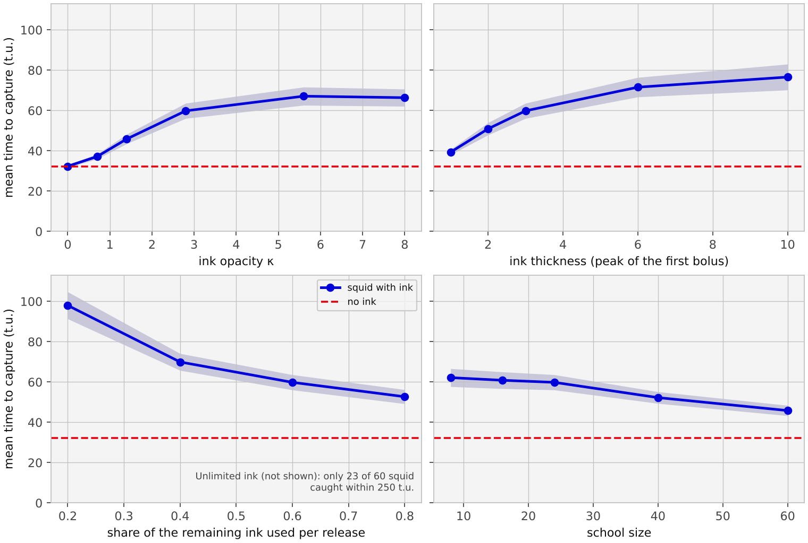

::: {.callout-tip}
## Optional extension

This page combines two ideas from earlier modules, **agents that move and interact** (Module 2) and **a field that spreads and fades** (Module 4). It extends the [confusion effect](../collective-behaviour/confusion-effect.qmd). There a school defends itself against one predator. Here the roles are reversed: **one prey, a squid, is hunted by a school of fish** and defends itself with a chemical and optical weapon. The question is: **can a squid defeat a whole school by hiding in its own ink?**
:::

A squid cannot outswim a school of fast fish for long. It has one trick that the fish do not: it can release a cloud of ink and leave. The ink has been proposed to work in several ways, as a chemical irritant, as a decoy shaped like the squid (a *pseudomorph*), and as a **smoke screen** that hides the squid from the eyes of the predator [@derby2014cephalopod]. Experiments with live predators support at least the optical and the decoy effects: ink delayed food capture by French grunts [@wood2010caribbean], and the visual effect of squid ink delayed the approach of summer flounder [@derby2013ink].

We model only the **smoke screen**. The model has three ingredients that you know from earlier pages: agents that move and interact locally (the fish follow Vicsek-type rules, as in the [Vicsek model](../collective-behaviour/vicsek-model.qmd)), a field that changes in time (the ink, as in the [reaction-diffusion](../pattern-formation/reaction-diffusion.qmd) module) and a coupling between the two (the fish pursue the squid only as well as they can see it). Coupling moving agents to a field is a common modelling pattern. A related one is the chemotactic predator and prey of Sengupta, Kruppa and Löwen [@sengupta2011chemotactic], where each animal follows the gradient of a chemical released by the other.

::: {.callout-note}
## What is and is not claimed

This is a **teaching model**. The parameters are chosen so that the mechanisms are visible and are not fitted to squid data. In a first literature search I did not find a model that combines a single inking prey, a schooling predator and a concentration-dependent loss of vision, but a first search is not a proof of novelty. Treat the combination as a question worth exploring, not as an established result.
:::

## The model

Lengths are in body lengths (BL) and time in arbitrary time units (t.u.). All animals live on a periodic square of side $L = 40$ BL.

| Ingredient | Rule |
|---|---|
| **Fish** (predators) | Align with neighbours, move toward the school, keep a minimum distance, and **pursue the squid** with a weight that depends on how well they see it. They are noticeably faster than the squid. |
| **Squid** (prey) | Cruises slowly. When the nearest fish comes within 8 BL it turns away and swims faster. If it still has ink and has not inked too recently, it releases a bolus at its position. Each release spends a share of the ink that is left in the sac. |
| **Ink** | A field $c$ on a $100 \times 100$ grid. In every step it spreads to the neighbouring cells, and cells with very little ink are reset to 0. The sac is **finite**: it starts full, and every release spends a share of what is left, so later clouds are thinner. |
| **Vision** | The pursuit weight of a fish is multiplied by the **transmission** along the line from the fish to the squid: the more ink on the way, the less it sees. |
| **Capture** | A fish within 0.8 BL of the squid catches it. A hunt that lasts 250 t.u. without a capture counts as an escape. |

### The ink: spread, dilute, disappear

The ink follows a simple local rule in every step. Each cell keeps a fraction $1 - s$ of its ink and gives $s/4$ to each of its four neighbours. Afterwards any cell with less than a threshold $\theta$ of ink is reset to exactly zero:

$$
c_{ij}' = (1 - s)\,c_{ij} + \frac{s}{4}\left(c_{i+1,j} + c_{i-1,j} + c_{i,j+1} + c_{i,j-1}\right),
\qquad
c_{ij}' \leftarrow 0 \ \text{ if } \ c_{ij}' < \theta .
$$ {#eq-spread}

With $s = 1/2$, half of the ink of a cell stays and half goes to its neighbours. The first part of the rule conserves the total amount of ink, and the second part removes it. A thick bolus (a large peak value) spreads farther and lasts longer before the threshold erases it, so the **thickness** of the ink is a parameter we can play with.

This rule is a discrete diffusion. Expanding it to second order in the grid spacing $\Delta x$ gives $c' - c \approx \tfrac{s}{4}\,\Delta x^2\,\nabla^2 c$ per step, which is the diffusion equation with an effective diffusion coefficient

$$
D_\text{eff} = \frac{s\,\Delta x^2}{4\,\Delta t_\text{ink}} .
$$ {#eq-deff}

With $s = 0.5$, $\Delta x = 0.4$ BL and three ink steps per time step of $0.12$ (so $\Delta t_\text{ink} = 0.04$) this is $D_\text{eff} = 0.5$ BL$^2$/t.u. The next figure shows one bolus spreading, and the numbers check @eq-deff: the variance of the cloud must grow as $\sigma^2(t) = \sigma_0^2 + 2 D_\text{eff}\, t$ while no cell is cut off.

```{python}
#| label: fig-ink-spread
#| fig-cap: "One bolus of ink after 0.1, 3, 10 and 30 time units. The cloud spreads and its peak falls, and the cut-off gives it a sharp edge. Each panel has its own colour scale. The numbers above each panel are the peak amount of ink in a cell and the share of the released ink still in the grid."
#| fig-alt: "Four heat maps of an ink cloud around the same point. The cloud widens from a small dark disc to a faint disc about thirteen body lengths across, while the peak falls from 2.6 to 0.05 and the ink left falls from 100 percent to 22 percent."
import numpy as np
import matplotlib.pyplot as plt
from dataclasses import replace
from amlab.collective_motion.squid_ink import InkParams, SquidInkSimulation

p = InkParams()
sim = SquidInkSimulation(p, seed=1)
sim.squid = np.array([20.0, 20.0])
sim._release_ink()
total0 = sim.ink.sum()

snapshots = {}
for step in range(1, 251):
    sim._spread_ink()
    if step in (1, 25, 83, 250):
        snapshots[step] = sim.ink.copy()

fig, axs = plt.subplots(1, 4, figsize=(11, 3.1), constrained_layout=True)
half = int(15 / sim.dx)
for ax, (step, ink) in zip(axs, snapshots.items()):
    window = ink[50 - half : 50 + half, 50 - half : 50 + half]
    ax.imshow(window, origin="lower", cmap="Blues", vmin=0, vmax=window.max(),
              extent=(-15, 15, -15, 15))
    ax.set_title(f"t = {step * p.dt:.1f}\npeak {ink.max():.2f}, ink left {100 * ink.sum() / total0:.0f} %", fontsize=9)
    ax.set_xticks([-10, 0, 10])
    ax.set_yticks([-10, 0, 10])
axs[0].set_ylabel("BL")
plt.show()

# check of the effective diffusion coefficient (no cut-off)
free = SquidInkSimulation(replace(p, threshold=0.0), seed=1)
free.squid = np.array([20.0, 20.0])
free._release_ink()
x = np.arange(p.grid) * free.dx

def variance_x(s):
    w = s.ink.sum(axis=0)
    w = w / w.sum()
    mu = (w * x).sum()
    return ((x - mu) ** 2 * w).sum()

v0 = variance_x(free)
for _ in range(250):
    free._spread_ink()
t = 250 * p.dt
d_eff = p.spread * free.dx**2 / (4 * p.dt / p.ink_steps)
print(f"D_eff = {d_eff:.2f}; variance after t = {t:.0f}: measured {variance_x(free):.2f}, predicted {v0 + 2 * d_eff * t:.2f}")
```

### Vision: a Beer-Lambert law

Light that travels through a medium that absorbs it fades exponentially with the amount of absorber on the way. For the fish $i$ at distance $d_i$ from the squid, let $\bar c_i$ be the mean ink concentration along the straight line between them. The transmission is

$$
\tau_i = \exp\!\left[-\left(a + \kappa\, \bar c_i\right) d_i\right],
$$ {#eq-transmission}

where $\kappa$ is the **opacity** of the ink and $a = 0.05$ BL$^{-1}$ is the small absorption of clear water, so that even without ink a distant squid is a little harder to see. In a dense cloud $\tau_i \approx 0$. The heading of the fish is steered by

$$
\mathbf{v}_i = w_\text{a}\,\mathbf{a}_i + w_\text{c}\,\mathbf{c}_i + w_\text{s}\,\mathbf{s}_i + w_\text{p}\,\tau_i\,\hat{\mathbf{p}}_i ,
$$ {#eq-pursuit}

where $\mathbf{a}_i$, $\mathbf{c}_i$ and $\mathbf{s}_i$ are the alignment, cohesion and separation terms of the school, and $\hat{\mathbf{p}}_i$ is the unit vector toward the squid. A fish that has lost the squid does not stop: it keeps moving with the school, so the school drifts on instead of turning around.

| Parameter | Value | | Parameter | Value |
|---|---|---|---|---|
| fish speed | 0.70 | | squid speed (cruise, flight) | 0.30, 0.45 |
| turning rate of a fish | 0.20 rad/step | | flight distance | 8 BL |
| weights $w_\text{a}, w_\text{c}, w_\text{s}, w_\text{p}$ | 1.1, 0.35, 1.4, 1.9 | | minimum time between releases | 5 t.u. |
| spreading fraction $s$ | 0.5 | | ink threshold $\theta$ | 0.002 |
| ink steps per time step | 3 | | bolus peak (thickness) | 3 (default) |
| opacity $\kappa$ | 2.8 (default) | | time step $\Delta t$ | 0.12 |
| clear-water absorption $a$ | 0.05 | | share of the remaining ink used per release | 0.6 (default) |
| ink sac is empty below | 5 % of a full sac | | | |

## Explore the hunt

The figure is the same model, ported to JavaScript. The camera follows the squid by default; the **Camera** button fixes the view on the whole sea. Fish are red arrows: a **filled** arrow can still see the squid, a **hollow** arrow has lost it in the ink. A white ring around the squid means that it has just inked and must wait before it can ink again; the label in the corner shows how much of the ink sac is left, and the squid itself turns from green to grey as the sac empties. **Recharge ink** refills it to 100%. The plot shows the mean visibility of the squid and the distance of the closest fish.

::: {.viz data-viz="squid-ink"}
1. Press **Ink: off** and watch about ten hunts. How long does the squid survive? Then switch the ink on again and compare the capture probability shown in the readout.
2. Set the opacity $\kappa$ to 0. Why does a cloud that does not absorb light give no protection, although the squid still releases ink?
3. Set **ink used per release** to 0.2 and then to 0.8. With 0.2 the squid releases many thin clouds, with 0.8 it releases two thick ones and then runs dry. Which survives longer? Then set it to 0 (unlimited ink). Is that realistic? Press **Recharge ink** during a hunt: how much does one refill buy?
4. Reduce the **thickness** to 1 and then raise it to 8. How does the shape of the cloud change, and how long does it hide the squid?
5. Compare a school of 12 with a school of 40 at the default ink. Does a bigger school find the squid more easily?
:::

## Run it on your computer

From the repository root:

```bash
# the animation with sliders (IE dark theme)
python amlab/collective_motion/squid_ink_animation.py

# options: light theme, a bigger school, thicker ink, a control without ink
python amlab/collective_motion/squid_ink_animation.py --theme light --fish 40 --thickness 5
python amlab/collective_motion/squid_ink_animation.py --no-ink

# save a GIF or an MP4 instead of opening a window (MP4 needs ffmpeg)
python amlab/collective_motion/squid_ink_animation.py --save squid-ink.gif --frames 300

# self-test and a short comparison with and without ink, without graphics
python amlab/collective_motion/squid_ink.py
```

In the window the sliders change the opacity, the thickness and the share of ink used per release live, and the school size restarts the hunt. **Ink on/off** switches the ink off, **Camera** (or **C**) switches between following the squid and a fixed view of the whole sea, **New hunt** starts again and **Space** pauses. The animation redraws only the moving parts, which keeps it smooth; use `--speed 1` on a slow computer.

## How the code works

The model is in `amlab/collective_motion/squid_ink.py`. The ink rule of @eq-spread is four array shifts:

```python
nb = np.roll(c, 1, 0) + np.roll(c, -1, 0) + np.roll(c, 1, 1) + np.roll(c, -1, 1)
c = (1.0 - spread) * c + (spread / 4.0) * nb      # keep a fraction, give the rest away
c[c < threshold] = 0.0                            # the cut-off
```

and the transmission of @eq-transmission samples the field at points along each line of sight:

```python
rays = wrap_delta(squid - fish, domain)                    # fish -> squid, on the torus
points = fish[:, None, :] + rays[:, None, :] * fractions[None, :, None]
mean_c = sample_ink(points).mean(axis=1)                   # mean ink on each sightline
tau = np.exp(-kappa * mean_c * distance)
```

`self_test()` checks that the same seed gives the same hunt, that the spreading rule conserves ink when the threshold is 0, that it is symmetric, that a cloud disappears, that the transmission falls as the opacity grows, that the squid never releases ink twice within the minimum interval and that the ink sac only ever empties.

To run your own experiment:

```python
from dataclasses import replace
from amlab.collective_motion.squid_ink import InkParams, hunt, sweep

res = sweep("kappa", [0.0, 1.0, 3.0], base=InkParams(), n_seeds=10, t_max=250.0)
print(res["values"], res["capture_prob"])
```

`sweep` runs `n_seeds` independent hunts for every value and returns the fraction in which the squid was caught within `t_max`. The next chunk compares a squid with and without ink on six random schools.

```{python}
#| label: tbl-ink-vs-none
import numpy as np
from dataclasses import replace
from amlab.collective_motion.squid_ink import InkParams, hunt

base = InkParams()
for label, par in [("no ink", replace(base, ink=False)), ("with ink", base)]:
    res = [hunt(par, seed, t_max=250.0) for seed in range(6)]
    caught = int(sum(r["captured"] for r in res))
    print(f"{label:9s} caught {caught} of 6 hunts, "
          f"mean time {np.mean([r['time'] for r in res]):5.1f}, "
          f"mean ink releases {np.mean([r['releases'] for r in res]):4.1f}")
```

## Experiment: how much does the ink help?

`run_experiments.py squid` reproduces the figure below. For each value of one parameter it runs **60 independent hunts** of at most 250 t.u. and records the time at which the squid is caught. The line is the mean, the band is a 95% confidence interval for the mean, and the dashed line is the same hunt without ink.

{#fig-squid-sweeps fig-alt="Four panels sharing one vertical axis, the mean time until capture in time units. A dashed line at about 32 is the squid without ink. Top left: the time rises from 32 at zero opacity to about 67 at opacity 5.6 and then stays flat. Top right: it rises from 39 to 77 as the ink thickness goes from 1 to 10. Bottom left: it falls from 98 to 53 as the share of ink used per release goes from 0.2 to 0.8. Bottom right: it falls slowly from 62 to 46 as the school grows from 8 to 60 fish."}

What the figure shows:

- **The squid is delayed, not saved.** In all 60 hunts of the default setting the squid is caught: after 60 t.u. on average, against 32 t.u. without ink. The ink buys roughly a factor of two in time.
- **Opacity saturates.** The mean time grows from 32 at $\kappa = 0$ to about 67 at $\kappa = 5.6$ and then stays flat, as Exercise 3 explains.
- **Thicker ink helps for longer**, because a thicker cloud is wider and lasts longer (39 t.u. at thickness 1, 77 at thickness 10).
- **Spending the sac in many small clouds is better than in two large ones**: the mean time falls from 98 t.u. when the squid uses 20% of what is left per release to 53 t.u. when it uses 80%. Thin clouds are enough to confuse the fish, and the squid keeps something in reserve.
- **Bigger schools find the squid sooner** (62 t.u. for 8 fish, 46 for 60), but only moderately: the fish pursue the same squid whatever the school size.
- **Unlimited ink is a different model.** With an endless supply the squid was caught in only 23 of 60 hunts within 250 t.u. (mean time 198 t.u., which is cut off at 250 t.u. and therefore too low). The limited sac is what turns an escape into a delay.

::: {.callout-note}
## Exercise 1: a cloud that does not absorb

With $\kappa = 0$ the squid still releases ink, and the cloud spreads exactly as before. Why does the squid get no protection? What does the figure say about the **cost** of releasing ink in the model?

:::

::: {.callout-tip collapse="true"}
## Solution

The ink acts only through the transmission $\tau = \exp[-(a + \kappa \bar c) d]$ of @eq-transmission. At $\kappa = 0$ only the weak clear-water term $a$ is left, whatever the concentration, so the fish pursue at full weight and the capture probability equals that of a squid without ink. The bottom-left panel of the figure and the unlimited-ink control show what ink costs in the model: a finite sac. With unlimited ink the squid would be caught in only 23 of 60 hunts; with the realistic sac it is always caught.
:::

::: {.callout-note}
## Exercise 2: the diffusion coefficient of the rule

Use the expansion of @eq-spread to derive @eq-deff. Then compute how long it takes the variance of a cloud to reach 36 BL$^2$ ($\sigma = 6$ BL) from an initial 0.8 BL$^2$.

:::

::: {.callout-tip collapse="true"}
## Solution

A cell gets $\tfrac{s}{4}$ of the ink of each neighbour and keeps $1 - s$, so $c_{ij}' - c_{ij} = \tfrac{s}{4}\,(c_{i+1,j} + c_{i-1,j} + c_{i,j+1} + c_{i,j-1} - 4 c_{ij})$. The bracket is $\Delta x^2\,\nabla^2 c$ to leading order, so one step changes $c$ by $\tfrac{s}{4}\Delta x^2\,\nabla^2 c$. Dividing by the duration $\Delta t_\text{ink}$ of the step gives $\partial_t c = D_\text{eff}\,\nabla^2 c$ with $D_\text{eff} = s\,\Delta x^2 / (4\,\Delta t_\text{ink})$. In one dimension the variance of a diffusing cloud grows as $\sigma^2 = \sigma_0^2 + 2 D_\text{eff}\,t$, so $t = (36 - 0.8) / (2 \times 0.5) = 35.2$ t.u. The cut-off makes the real cloud smaller than this and finally erases it.
:::

::: {.callout-note}
## Exercise 3: thick or thin ink

A thicker bolus covers a larger area for longer. Why can the benefit of thicker ink still saturate? Think about the transmission of @eq-transmission when $\bar c\, d$ is already large.

:::

::: {.callout-tip collapse="true"}
## Solution

The transmission depends on the product $\kappa\,\bar c\,d$ in an exponential. Once the optical depth $\kappa\,\bar c\,d$ is a few units, $\tau$ is already close to 0, and more ink only makes a very small number even smaller. The extra ink then helps only through its **extent**: a wider cloud takes more time to cross and to leave. Compare the plateau of the opacity curve in @fig-squid-sweeps with the thickness curve, which keeps rising.
:::

::: {.python-next}
**Build this in Python.** Use `sweep` to vary the **ink thickness** and the **spreading fraction** `spread` of @eq-spread. Which of the two controls the capture probability, and why? Then add a **decoy**: let fish within 3 BL of the ink maximum steer toward it for a few time units. Does a decoy help more than a smoke screen alone?
:::

## Biological reality check

How well does the model match what is known about cephalopod inking? The points below separate what the model keeps from what it leaves out.

**What matches.**

- *Ink delays, it does not guarantee escape.* Live predators were slowed, not stopped, by ink [@wood2010caribbean; @derby2013ink], and Derby's review lists decoy, smoke screen and chemical effects as complementary roles [@derby2014cephalopod]. Our default squid is delayed by about a factor of two.
- *The ink sac is finite and refills slowly.* In the cuttlefish *Sepia pharaonis* a full sac held about 765 mg of ink, and three inkings in a row released about 498, 178 and 38 mg; refilling took about 30 days [@jiang2019continuous]. Each release therefore spent roughly half or more of what was left, which is the rule of our model with a share of 0.6 per release. The default value is a round number inspired by these data, not a fit.
- *Spreading and dilution.* A real cloud expands and thins out in seconds to minutes, and a **smoke screen** and a **pseudomorph** (a compact, squid-sized blob of mucus-rich ink) are different tactics [@derby2014cephalopod]. The model has only the first.

**What is simplified or missing.**

- *The squid is not stealthy afterwards.* Real cephalopods often blanch, change colour and jet away *in the shadow of the cloud*, so the predator searches the wrong place. In the model the squid simply keeps its heading and speed, and the fish lose it only because the cloud blocks the line of sight.
- *Vision is the only channel.* Fish also sense the pressure and flow wake of a jetting squid with the lateral line, and the ink has chemical effects on taste and smell [@derby2014cephalopod]. Both are ignored. This makes the model pessimistic for the fish side in one respect and optimistic in another, and we do not know which wins.
- *The box has no far away.* On a periodic square the squid cannot escape by distance, so ink can only delay the end. In open water a squid that breaks the line of sight may simply never be found.
- *Fish and squid speeds are chosen, not measured.* The fish are faster than the squid by assumption; the result depends on this ratio.
- *Ink is released as a Gaussian blob at rest.* In reality it is ejected in a jet, so the first shape of the cloud is set by the water flow.

The honest summary is this: the model captures the *logic* of a finite, optical smoke screen, and its qualitative message (ink buys time, and how the sac is spent matters) is consistent with the experiments cited. It does not support quantitative statements about real squid.

## Waves instead of ink

Fish and other aquatic animals do not rely on sight alone. A predator that moves through water disturbs it, and other animals can sense the disturbance with mechanoreceptors: copepods detect the flow produced by an approaching fish and escape in a direction away from it [@tuttle2019going], and killifish use a hydrodynamic sensory antenna to hunt at night [@schwarz2011hydrodynamic]. This suggests a different field-plus-agents model. A moving predator produces a damped flow field. The prey estimates the direction of the predator from a local spatial gradient of that field, and the school changes its motion in response. The field could be a diffusion-like decay, as here, or a wave equation with a propagation speed and a damping that are separate from the local response of the receptor.

This is a better-grounded use of the word **wave** than forcing a chemical Turing pattern onto squid ink: the ink field here only spreads and fades, and it cannot produce a traveling or a self-organized pattern. A pattern-forming ink would need a reaction term, which the real ink does not have.

## What this model does not do

- It is a **teaching model**. The parameters are not fitted to data, and the numbers in @fig-squid-sweeps should not be read as predictions for real squid.
- The ink supply is finite, but the refill is not modelled (a real sac needs about a month) and the ink has chemical effects (irritation, disruption of smell) that we do not model.
- The squid does not use the ink strategically. A real squid changes colour, jets away and sometimes releases the ink as a decoy rather than a screen.
- The fish see the squid through a single number, the transmission of the line between them. Real vision is limited by contrast, by the angle and by the size of the target.
- The ink spreads by a diffusion-like rule. Real ink is carried by the flow and by the jet of the squid.
